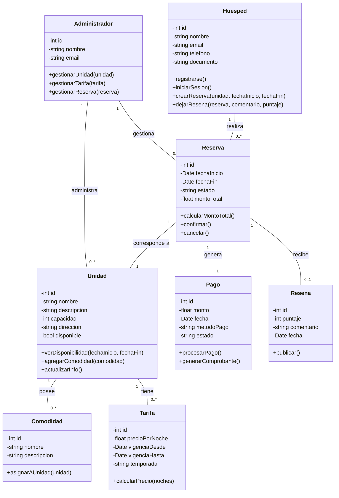

##  Identificación de entidades principales

A partir del análisis del negocio se identifican las siguientes entidades:

- **Unidad / Departamento (Loft)**: cada unidad disponible para alquiler, con sus características (capacidad, ambientes, comodidades, tarifa).
- **Huésped**: persona que reserva y se aloja en una unidad.
- **Reserva**: vincula un huésped con una unidad en un rango de fechas.
- **Tarifa**: precio aplicable a una unidad según temporada o duración de la estadía.
- **Comodidad/Servicio**: características ofrecidas por cada unidad (Wi-Fi, cocina, aire acondicionado, etc.).
- **Pago**: transacción asociada a una reserva.
- **Administrador**: usuario interno que gestiona unidades, tarifas y reservas.
- **Reseña**: opinión dejada por el huésped luego de la estadía.

---

##  Diagrama de clases (UML simplificado)

### Descripción de relaciones

- **Huésped → Reserva** (1 a muchos): un huésped puede realizar varias reservas.
- **Reserva → Unidad** (muchos a 1): cada reserva corresponde a una única unidad.
- **Reserva → Pago** (1 a 1): cada reserva genera un pago asociado.
- **Reserva → Reseña** (1 a 0..1): una reserva finalizada puede tener una reseña.
- **Unidad → Comodidad** (1 a muchos): cada unidad posee varias comodidades.
- **Unidad → Tarifa** (1 a muchos): una unidad puede tener distintas tarifas según temporada.
- **Administrador → Unidad / Reserva** (1 a muchos): el administrador gestiona múltiples unidades y reservas.
